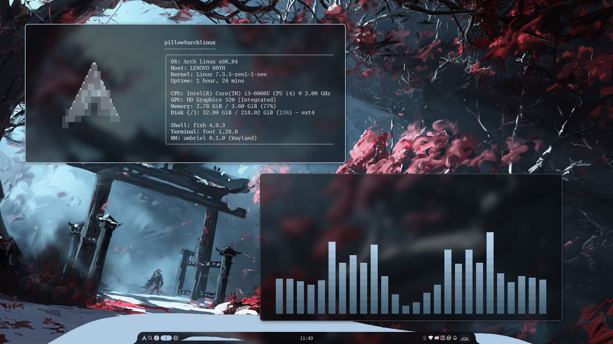

<div align="center">
  
  # nocalamity
  
My Umbriel + Noctalia dotfiles



</div>

## requirements
- Linux (prefferably arch)
- Noctalia (latest), or atleast v5
- Umbriel window manager
- Bongo cat noctalia plugin
- Cursor noctalia plugin
- Umbriel companion noctalia plugin 
- Foot terminal
- areofyl/fetch
- GoMono nerd fonts

## installation
We have automated installation, but its split in 2 files so you can install the noctalia plugins first.

### `bin/core_install.sh` - installs an AUR helper, umbriel, noctalia etc.

After running it, start Umbriel in your login manager, and open the terminal (foot).
Then run this:
```bash
noctalia & disown
```

Skip the setup. Go to
`Settings > Plugins > Browse plugins`.

Install these 3:
- Bongo Cat
- Umbriel companion
- Cursor

After run the next script;

### `bin/rest_install.sh` - This deploys the dotfiles and completes the nocalamity installation.

Curiously, the Umbriel configuration is applied before the `rest_install.sh` so Umbriel doesnt ask you to use kitty instead of foot.
